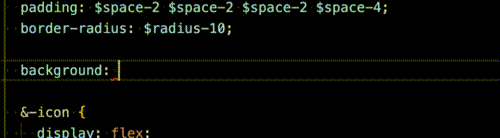

# Servicelead

Affiliate dashboard for a [CPA-Network](https://servicelead.ru)

## Stack
`Docker` `Nuxt 4` `Typescript` `ESLint` `Stylelint` `SCSS` `pnpm` `Storybook` `Yup`

## Features
- **Consistent development environment**
- **Linting, Formatter, and Auto-fix scripts** `VS Code only`
- **Linting, Formatter, and Auto-fix styles** `VS Code only`
- **Linting, Formatter, and Auto-fix template** `VS Code only`
- **SCSS snippets** `VS Code only`
- **Docker-based isolation**

# 🚀 Get Started

## Before You Start

Please check the following before starting work on the project:

1. Read [ExampleComponent.vue](app/components/ExampleComponent.vue)
2. Review the [design system](app/assets/design-system) SCSS variables
3. Read about [SCSS snippets](#scss-snippets)
4. Check available [Composables](#use-composables)
5. Check available [Utils](#use-utils)
6. Read about [Conventional Commits](#use-conventional-commits)

## Use Snippets
> [!Note]
> Currently available only in VS Code

Just start typing...



### SCSS Snippets

#### `text` – get text typography @mixin
```scss
@include text(regular, sm);
```
#### `label` – get label typography @mixin
```scss
@include label(md, medium);
```
#### `color` – get color palette $variable
```scss
background: $color-neutral-50;
```
#### `radius` – get border radius $variable
```scss
border-radius: $radius-2;
```
#### `space` – get spacing $variable
```scss
gap: $space-2;
```
#### `duration` – get duration $variable
```scss
transition: $duration-blur-sm;
```
#### `ixxl`, `ixl`, `ilg`, `imd`, `ism`, `ixs` – get media query @mixin
```scss
@include xs {
  display: none;
}
```
#### `is` – get the class‑state @include from the style system
```scss
@include is($root-component-class-state) {
  display: none;
}
```

## Use Conventional Commits

**Стркутура коммита:**  
`type`(`scope`): `subject`

`type`: Заголовок коммита, указывающего на специфику внесенных в кодовую базу изменений  
`scope`?: Область, бизнес-логика или логическая самостоятельная часть приложения, характеризующая фрагмент кода, которую затронули изменения (не обязательно)  
`subject`: Описание в повелительном наклонении (imperative mood)

| Types         | Is                                                              |
| ------------- | --------------------------------------------------------------- |
| build         | Сборка проекта или изменения внешних зависимостей               |
| ci            | Настройка CI и работа со скриптами                              |
| docs          | Обновление документации                                         |
| feat          |	Добавление нового функционала                                   |
| fix           |	Исправление ошибок                                              |
| perf          | Изменения направленные на улучшение производительности          |
| refactor      |	Правки кода без исправления ошибок или добавления новых функций |
| revert        |	Откат на предыдущие коммиты                                     |
| style	        | Правки по кодстайлу (табы, отступы, точки, запятые и т.д.)      |
| chore         |	Изменения, не связанных напрямую с кодом приложения             |
| test	        | Добавление тестов                                               |

**Примеры:**  
fix(offer): error when save offer to favorite  
feat(AppIcon): setup component  
style: add space after function in Component  
docs(readme): add Use Conventional Commits block  
docs(AppButton): add jsondoc to props  

<details>
<summary>ℹ️ Подробнее про scope</summary>

### Основной принцип

`scope` определяется по бизнес-логике и функциональной самостоятельности, а не по структуре папок.

Он отвечает на вопрос:  
**какую часть продукта затрагивает этот коммит?**

Если часть приложения:
- имеет собственное назначение
- является самостоятельной логической единицей
- объединяет внутри себя страницы, компоненты и другую логику

то это и есть `scope`.

### Логические части приложения

Крупные функциональные области проекта, которые уже используются как `scope`:

- `offers`
- `news`
- `tickets`
- `finance`
- `statistics`
- `auth`
- `navigation`
- `layout`
- `types`
- `и другие`

### Примеры правильного использования

#### Страницы

Страница часто относится к самостоятельной логической части приложения.

Бывает сама по себе отдельным scope:
- `dashboard` → `scope: dashboard`

Бывает частью более большой scope:
- `/offers` → `scope: offers`
- страница одного оффера (`/offers/[id]`) → `scope: offers`

#### Компоненты

Имена компонентов не образуют `scope`, 
если не являются самостоятельной логической частью приложения или глобальным компонентом (components/app)

пример news/Entry.vue:

Правильно:  
`feat(news): add new fields to Entry`

Неправильно:  
`feat(entry): add new block`
`fix(newsEntry): update layout`

#### Глобальные компоненты (components/App)

Компоненты из папки `App` являются глобальными, поэтому их `scope` считается за них самих.

- `feat(AppIcon): add new size option`
- `fix(AppButton): correct disabled state styles`
- `style(AppTabs): align typography with design system`

#### Composables и бизнес-логика

`scope` определяется по бизнес-сущности, а не по месту использования.

- форма ввода SMS-кода → `auth`
- логика статусов тикетов → `tickets`

Примеры:
- `feat(auth): add sms code input form`
- `fix(tickets): correct status color mapping`

</details>

## Use Composables
- [useConfirmDialog](docs/composables/use-confirm-dialog.md) — confirm dialog helper
- [useOverlay](docs/composables/use-overlay.md) — shared overlay manager
- [useBreakpoints](docs/composables/use-breakpoints.md) — responsive breakpoint helpers
- [useDocumentScrollLock](docs/composables/use-document-scroll-lock.md) — document scroll lock helper

## Use Utils
- [search](docs/utils/search.md) — Fuse.js search wrapper

## Use Validation
- [validation](docs/validation.md) — Yup validation with and without `AppForm`

## 📦 Требования

Перед началом убедитесь, что установлено:

- ✅ **Docker Desktop / Docker Engine**
- ✅ **VS Code**
- ✅ **Расширение Dev Containers** (`ms-vscode-remote.remote-containers`)

---

## ⚙️ Запуск проекта

### 1. Откройте проект в VS Code

При первом открытии VS Code предложит установить Dev Containers:


Если не предложил — установите расширение вручную:  
https://marketplace.visualstudio.com/items?itemName=ms-vscode-remote.remote-containers

---

### 2. Откройте проект в контейнере

После установки расширения VS Code обнаружит конфиг `.devcontainer/devcontainer.json` и предложит собрать образ и открыть контейнер:


Также можно открыть контейнер вручную (или пересобрать образ и открыть):

> **Ctrl + Shift + P → Dev Containers: Reopen in Container**


После сборки вы автоматически окажетесь в среде контейнера (`Dev Container`).

Контейнер будет виден в Docker Desktop.
  
---

### 3. Запуск nuxt в dev режиме в терминале VS Code в конейнере

```bash
pnpm dev:container
```

---

## 📥 Установка пакетов

Все зависимости ставятся **только внутри контейнера**, в терминале VS Code.

```bash
pnpm i <package-name>
```

Установка Nuxt-модулей

```bash
npx nuxi module add <module-name>
```

Пример установки пакета из терминала внутри контейнера:


## How to run on a VPS

1. Install Docker and Docker Compose
> [!important]
> Don’t forget to enable Docker service auto-start and add your user to the `docker` group (so you can run Docker without sudo)

2. Clone the repository:
```bash
git clone git@github.com:qleager/servicelead.git
```

3. Go to the cloned repository directory:
```bash
cd servicelead
```

4. Start:
```bash
docker compose -f docker-compose.yml -f docker-compose.production.yml up -d --build
```

## How to update
```bash
cd /to/project/directory/
git pull
docker compose -f docker-compose.yml -f docker-compose.production.yml up -d --build
```


## 📥 Как именовать коммиты:
https://habr.com/ru/companies/yandex/articles/431432/
